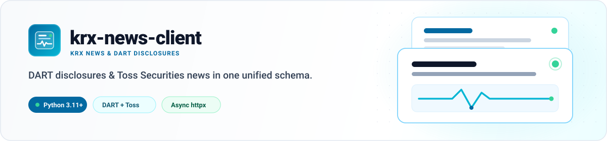
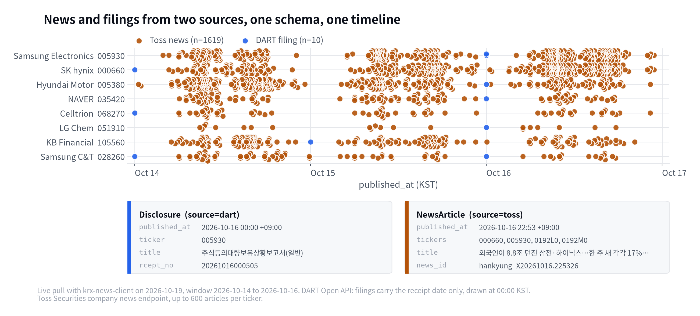

<picture>
  <source media="(prefers-color-scheme: dark)" srcset="docs/images/brand/banner-dark.svg">
  
</picture>

[한국어](README.md) | **English**

**A Python client for DART disclosures and Toss Securities news in one unified schema — including full article bodies and per-ticker historical news, in one `pip install`.**

[](https://github.com/younghwan91/krx-news-client/actions/workflows/ci.yml)
[](https://www.python.org/downloads/)
[](LICENSE)
[](https://www.linkedin.com/in/younghwan-chae/)

<picture>
  <source media="(prefers-color-scheme: dark)" srcset="docs/images/hero-dark.png">
  
</picture>

- **Two sources, one timeline.** Disclosures (`Disclosure`) and news articles (`NewsArticle`) share `id`, `source`, `title`, `url`, and `published_at` (tz-aware KST). Adding more sources does not change caller code.
- **Exceptions instead of silent zeros.** Toss is an unofficial internal API and can change without notice. If the per-ticker news response shape changes, it raises `TossResponseError` instead of returning an empty list (for the dashboard feed, pass `scrape_news(strict=True)`). Invalid ticker codes and page sizes are rejected with `ValueError` before making a request.
- **Paginated per-ticker news history.** Up to 100 items per page, up to Toss's 10,000-item offset limit (for large-cap stocks, that covers less than 6 months).

## Quick Start

```bash
pip install krx-news-client   # Python 3.11+
```

> `fetch_article_detail_raw`, 10,000-offset limit handling for per-ticker news, `size` validation, and DART key log masking landed after the latest PyPI release (0.4.0) and are currently only on `main`.
> To use them: `pip install "krx-news-client @ git+https://github.com/younghwan91/krx-news-client"`.

```python
import asyncio
from krx_news_client import TossScraper

async def main():
    async with TossScraper() as scraper:
        articles = await scraper.scrape_news()
        for article in articles[:5]:
            print(article.nation, article.title, article.published_at)

asyncio.run(main())
```

```
KR 코스피, 외국인 순매수에 2%대 상승 마감 2025-06-10 15:30:00+09:00
US 엔비디아, 실적 발표 앞두고 강세 2025-06-10 14:05:00+09:00
...
```

## What It Does

| Source | Data | Collection Method |
|---|---|---|
| DART (dart.fss.or.kr) | Disclosure list & full text | Official Open API (API key required) |
| Toss Securities (tossinvest.com) | Dashboard news, article body, per-ticker news | Unofficial internal API |

- `TossScraper.scrape_news()` — **Current snapshot** of the dashboard feed. Roughly half are US articles (`nation="US"`), bodies are empty, and it cannot paginate backward.
- `TossScraper.fetch_article_detail()` / `fetch_article_detail_raw()` — Full article body, sentiment label, and original publisher URL. `_raw` returns the raw dict.
- `TossScraper.scrape_company_news()` / `company_news_page()` — Paginate per-ticker news backward in time. The former returns a normalized list; the latter returns one page as a raw dict.
- `DartScraper.scrape_disclosures()` — Disclosure list (default: yesterday–today KST, all markets). Pass multiple keys to auto-rotate when hitting the 20,000/day limit.
- `DartScraper.search_disclosures*()` / `fetch_document()` — Raw DART responses and full disclosure text (`document.xml`). Strict path for backfilling.
- `Deduplicator` — Yields only unseen items when polling (by `id` for articles, `rcept_no` for disclosures).

### Toss: Article Bodies & Per-Ticker History

```python
from datetime import date

async with TossScraper() as scraper:
    detail = await scraper.fetch_article_detail(articles[0].url)  # Full body, sentiment label, original URL
    raw = await scraper.fetch_article_detail_raw(articles[0].url)  # Same as raw dict (preserves body block structure)
    history = await scraper.scrape_company_news(                  # Per-ticker news, paginated backward
        "005930", since=date(2025, 6, 1), max_pages=20     # date = 00:00 KST of that day
    )
    items, _ = await scraper.company_news_page("005930", number=1)  # One page as raw dict
```

### DART: Polling & Backfilling

```python
from krx_news_client import DartScraper

async with DartScraper(api_key="...") as scraper:   # or DartScraper.from_env()
    disclosures = await scraper.scrape_disclosures()  # Default: yesterday–today (KST), all markets

scraper = DartScraper(api_key=["key1", "key2", "key3"])  # Auto-rotates to next key on quota exceeded
disclosures = await scraper.scrape_disclosures(
    bgn_de="20250101", end_de="20250331", corp_cls="Y"  # Y=KOSPI, K=KOSDAQ, N=KONEX
)
```

For raw DART responses, use `search_disclosures` (one page), `search_disclosures_all` (all pages), or `search_disclosures_range` (multi-year, multi-market). DART restricts searches without a specific company to **3 calendar months**, which `search_disclosures_range` splits automatically via `quarter_ranges`:

```python
rows = await scraper.search_disclosures_range(bgn_de="20160901", end_de="20260915", corp_cls=["Y", "K"])
docs = await scraper.fetch_document(rows[0]["rcept_no"])  # Disclosure text (document.xml) -> docs[0].text
```

API keys never appear in logs — instantiating `DartScraper` masks `crtfc_key=…` with `***` in `httpx` loggers and raised exception messages (log levels unchanged). Code that logs request URLs directly can call `mask_secrets()`.

### Polling

```python
from krx_news_client import Deduplicator

dedup = Deduplicator()
while True:
    for article in dedup.filter_new(await toss.scrape_news()):
        handle(article)
    await asyncio.sleep(180)
```

The same scraper instance can be called across multiple `asyncio.run` invocations (it recreates the HTTP client when the event loop changes). More examples are in [`examples/`](examples/).

## Design Rationale

- **A library, not a server.** No scheduler, cache, or storage layer. It queries sources on demand inside the caller's process and returns normalized records; persistence belongs to the caller ([quant-airflow](https://github.com/younghwan91/quant-airflow) uses this library to ingest into TimescaleDB). Same philosophy as [kiwoom-client](https://github.com/younghwan91/kiwoom-client).
- **Exceptions beat silent zeros.** Because outputs feed backtests and live trading, an empty list mistaken for "no news that day" leaves silent holes in the data. Schema changes in per-ticker news raise `TossResponseError` (the dashboard feed defaults to `strict=False` to skip failed feeds, or raises with `strict=True`), bad arguments raise `ValueError`, and DART quota exhaustion raises `DartQuotaExceededError` to distinguish "no disclosures" (`status=013`) from "quota exceeded" (`status=020`).
- **Strict and tolerant paths stay separate.** `search_disclosures*` propagates `DartAPIError` (for backfills), whereas `scrape_disclosures` logs error pages and returns everything collected so far (for live polling).
- **News and disclosures only.** Toss supply/demand, order books, AI signals, and real-time rankings are excluded. Official APIs exist for order flow/books, and signals/rankings cannot be reproduced historically.
- **All timestamps are tz-aware KST.** Korean tickers are normalized to 6 digits.

## Toss Caveats

Because Toss is an **unofficial internal API**, it may break or block requests without notice. Pitfalls verified on the per-ticker news endpoint (`/api/v2/news/companies/{code}`) as of 2026-09-15 and 2026-10-05:

- **6-digit codes only.** Passing `A005930` or an ISIN returns 0 items with no error. The library strips a leading `A` and raises `ValueError` for any other format.
- **1-indexed pages.** `number=0` returns HTTP 400 from Toss, so `ValueError` is raised before the request.
- **Max page size is 100.** `size=101` or higher returns an empty page with no error, so `ValueError` is raised.
- **10,000-item offset limit.** When `number × size` exceeds 10,000, Toss returns HTTP 400 (`pagination-limit`). Because it is offset-based rather than page-count-based, shrinking `size` does not reach further back. `scrape_company_news` logs a warning and stops just before the limit; `company_news_page` raises `ValueError` before requesting. For large-cap stocks, 10,000 items is less than 6 months.
- **`lastPage` is unreliable.** Even when a page is just a few items short of `size`, `lastPage` can return `True` while more pages remain. `scrape_company_news` therefore paginates until an empty page is returned.
- **Ordering is approximate.** Items within a page are not strictly sorted, and adjacent pages overlap by roughly a day. `since` therefore stops only when an entire page is older than `since`, and results are deduplicated by `id` and sorted newest-first.
- **Market-wide articles are mixed in.** Articles such as "KOSPI close" have no `stockCodes`, so `tickers` is empty.

Request throttling defaults to 0.5–1.5s random jitter for Toss (`BaseScraper` defaults to 0.5–2.0s) to stay conservative against rate-limiting on an unofficial API. Adjust `scraper.min_delay` and `scraper.max_delay` if higher throughput is needed. DART is an official API constrained only by daily quota, so its delay is 0.

## Response Fields

`NewsArticle`

| Field | Description |
|---|---|
| `id` | Unique ID (`{source}:{12-char md5 of url}`) |
| `source` | Source (`dart` / `toss`) |
| `category` | `disclosure` / `market` / `stock` / `economy` / `analysis` / `breaking` |
| `title` | Headline |
| `url` | Article URL |
| `content` | Body text (populated by `fetch_article_detail` and `scrape_company_news`) |
| `summary` | Summary |
| `tickers` | Related tickers: 6-digit codes for KR stocks (e.g. `005930`), Toss raw codes for overseas stocks |
| `author` | Author / publisher |
| `published_at` | Publication timestamp (tz-aware KST) |
| `collected_at` | Collection timestamp |
| `news_id` | Toss article ID |
| `nation` | Target market (`KR` / `US`) |
| `sentiment` | Toss sentiment label (on detail fetch) |
| `original_url` | Original publisher URL (on detail fetch) |

`Disclosure` shares `id`, `source`, `title`, `url`, `published_at`, and `collected_at`, omits `category`, `content`, `summary`, `tickers`, and `author`, and adds:

| Field | Description |
|---|---|
| `company` · `ticker` | Company name · Ticker (empty string if unlisted) |
| `disclosure_type` | Raw disclosure title (`report_nm`) |
| `rcept_no` | Receipt number — ordering within the same day, deduplication key |
| `corp_code` · `corp_cls` | DART corp code · Market class (`Y` / `K` / `N` / `E`) |
| `rm` | DART remarks |
| `is_correction` | Whether it is a correction filing starting with `[기재정정]`, `[첨부정정]`, etc. |

`published_at` is 00:00 KST on the filing **date** — the DART list API does not include filing time.

## Architecture

```mermaid
flowchart LR
    Caller["Caller Process\n(e.g. quant-airflow)"]

    subgraph Client["krx-news-client"]
        direction TB
        Toss["TossScraper\n.scrape_news()\n.fetch_article_detail()\n.scrape_company_news()"]
        Dart["DartScraper\n.scrape_disclosures()\n.search_disclosures_range()\n.fetch_document()"]
        Base["BaseScraper\nRandom UA · Throttling\nRetries · 429 Backoff"]
        Schema["schemas.py\nNewsArticle · Disclosure\nDisclosureDocument"]

        Toss --> Base
        Dart --> Base
        Toss -->|_make_article| Schema
        Dart -->|_make_disclosure| Schema
    end

    TossAPI[("Toss Securities\nwts-info-api\n(Unofficial internal API)")]
    DartAPI[("DART\nopendart.fss.or.kr\n(Official Open API)")]

    Caller -->|await scraper.scrape_news()\n / scrape_disclosures()| Client
    Base -->|POST dashboard feed\nGET article detail & company news| TossAPI
    Base -->|GET list.json\n/ document.xml| DartAPI
    Client -->|list[NewsArticle]\n / list[Disclosure]| Caller
```

`BaseScraper` handles shared transport concerns (retries on 429/5xx only, 429 backoff), while each scraper only parses source responses into normalized schemas.

## License

Apache License 2.0 — see [LICENSE](LICENSE) for details.

## Contributing & Issues

- 🐛 Bug reports, questions, feature requests: [GitHub Issues](https://github.com/younghwan91/krx-news-client/issues)
- 📈 Updates: [Follow @younghwan91](https://github.com/younghwan91)

## Author

**Younghwan Chae (채영환)** · [GitHub @younghwan91](https://github.com/younghwan91) · [LinkedIn](https://www.linkedin.com/in/younghwan-chae/)

See the full open-source quant stack on my [GitHub profile](https://github.com/younghwan91).
