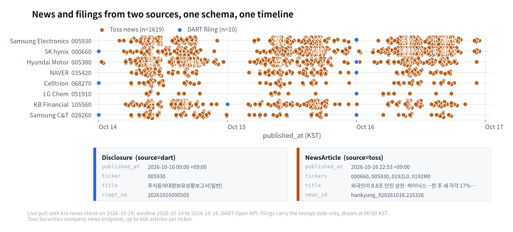

# krx-news-client

**DART 공시와 토스증권 뉴스를 한 스키마로 받는 Python 클라이언트 — 기사 본문과 종목별 과거 뉴스까지, `pip install` 한 줄.**

[](https://github.com/younghwan91/krx-news-client/actions/workflows/ci.yml)
[](https://www.python.org/downloads/)
[](https://github.com/younghwan91/krx-news-client/blob/main/LICENSE)
[](https://www.linkedin.com/in/younghwan-chae/)

<picture>
  <source media="(prefers-color-scheme: dark)" srcset="docs/images/hero-dark.png">
  
</picture>

- **두 출처, 한 타임라인.** 공시(`Disclosure`)와 기사(`NewsArticle`)가 `id`·`source`·`title`·`url`·`published_at`(KST, tz 포함)을 같은 이름으로 갖는다. 출처가 늘어도 호출 코드는 그대로다.
- **조용한 0건 대신 예외.** 토스는 비공식 내부 API라 예고 없이 바뀔 수 있다. 종목별 뉴스 응답의 형식이 달라지면 빈 목록을 돌려주지 않고 `TossResponseError`를 올린다(대시보드 피드는 `scrape_news(strict=True)`를 주면 예외). 잘못된 종목코드·페이지 크기는 요청 전에 `ValueError`로 막는다.
- **종목별 과거 뉴스를 페이지로 넘긴다.** 100건씩, 토스가 허용하는 오프셋 10,000건까지. 대형주는 그게 6개월에 못 미친다.

## 빠른 시작

```bash
pip install krx-news-client   # Python 3.11 이상
```

```python
import asyncio
from krx_news_client import TossScraper

async def main():
    async with TossScraper() as scraper:
        articles = await scraper.scrape_news()
        for article in articles[:5]:
            print(article.nation, article.title, article.published_at)

asyncio.run(main())
```

```
KR 코스피, 외국인 순매수에 2%대 상승 마감 2025-06-10 15:30:00+09:00
US 엔비디아, 실적 발표 앞두고 강세 2025-06-10 14:05:00+09:00
...
```

## 무엇을 하나

| 소스 | 데이터 | 수집 방식 |
|---|---|---|
| DART (dart.fss.or.kr) | 공시 목록·원문 | 공식 Open API (키 필요) |
| 토스증권 (tossinvest.com) | 대시보드 뉴스·기사 본문·종목별 뉴스 | 비공식 내부 API |

- `TossScraper.scrape_news()` — 대시보드 피드의 **현재 스냅샷**. 해외(`nation="US"`) 기사가 절반 가까이 섞여 있고 본문은 비어 있으며 과거로 넘길 수 없다.
- `TossScraper.fetch_article_detail()` / `fetch_article_detail_raw()` — 기사 본문 전체·감성 라벨·언론사 원문 URL. `_raw`는 원본 dict.
- `TossScraper.scrape_company_news()` / `company_news_page()` — 종목별 뉴스를 과거로 페이징. 전자는 정규화된 목록, 후자는 원본 dict 한 페이지.
- `DartScraper.scrape_disclosures()` — 공시 목록(기본: 어제~오늘 KST, 전체 시장). 키를 여러 개 주면 일 20,000건 한도를 넘길 때 다음 키로 자동 전환.
- `DartScraper.search_disclosures*()` / `fetch_document()` — DART 원본 응답과 공시 원문(`document.xml`). 백필용 엄격 경로.
- `Deduplicator` — 폴링할 때 처음 본 것만 넘긴다(기사는 `id`, 공시는 접수번호 기준).

### 토스: 본문·종목별 이력

```python
from datetime import date

async with TossScraper() as scraper:
    detail = await scraper.fetch_article_detail(articles[0].url)  # 본문 전체·감성 라벨·언론사 원문 URL
    raw = await scraper.fetch_article_detail_raw(articles[0].url)  # 같은 것을 원본 dict 로(본문 블록 구조 유지)
    history = await scraper.scrape_company_news(                  # 종목별 뉴스, 과거로 페이징
        "005930", since=date(2025, 6, 1), max_pages=20     # date 는 그날 00:00 KST
    )
    items, _ = await scraper.company_news_page("005930", number=1)  # 원본 dict 한 페이지
```

### DART: 폴링과 백필

```python
from krx_news_client import DartScraper

async with DartScraper(api_key="...") as scraper:   # 또는 DartScraper.from_env()
    disclosures = await scraper.scrape_disclosures()  # 기본: 어제~오늘(KST), 전체 시장

scraper = DartScraper(api_key=["key1", "key2", "key3"])  # 한도 초과 시 다음 키로 자동 전환
disclosures = await scraper.scrape_disclosures(
    bgn_de="20250101", end_de="20250331", corp_cls="Y"  # Y=코스피, K=코스닥, N=코넥스
)
```

DART 원본 응답이 필요하면 `search_disclosures`(한 페이지)/`search_disclosures_all`(전 페이지)/`search_disclosures_range`(여러 해·여러 시장). DART는 기업을 지정하지 않은 검색을 **달력 3개월**로 제한하는데, `search_disclosures_range`가 `quarter_ranges`로 알아서 쪼갠다:

```python
rows = await scraper.search_disclosures_range(bgn_de="20160901", end_de="20260915", corp_cls=["Y", "K"])
docs = await scraper.fetch_document(rows[0]["rcept_no"])  # 공시 원문(document.xml) → docs[0].text
```

키는 로그에 남지 않는다 — `DartScraper`를 만들면 `httpx` 로거와 올리는 예외 메시지에서 `crtfc_key=…`가 `***`로 가려진다(로그 레벨은 그대로). 요청 URL을 직접 로그에 쓰는 코드는 `mask_secrets()`를 거치면 된다.

### 폴링

```python
from krx_news_client import Deduplicator

dedup = Deduplicator()
while True:
    for article in dedup.filter_new(await toss.scrape_news()):
        handle(article)
    await asyncio.sleep(180)
```

같은 스크레이퍼를 `asyncio.run`으로 여러 번 불러도 된다(이벤트 루프가 바뀌면 HTTP 클라이언트를 새로 만든다). 더 많은 예제는 [`examples/`](examples/)에 있다.

## 왜 이렇게 만들었나

- **서버가 아니라 라이브러리다.** 스케줄러·캐시·저장 계층이 없다. 호출한 프로세스 안에서 그때그때 매체에 요청해 정규화된 결과를 돌려주고, 저장은 호출자 몫이다([quant-airflow](https://github.com/younghwan91/quant-airflow)가 이 라이브러리로 수집해 TimescaleDB에 적재한다). [kiwoom-client](https://github.com/younghwan91/kiwoom-client)와 같은 성격이다.
- **조용한 0건보다 예외가 낫다.** 결과가 백테스트·실매매 입력이라 빈 결과가 "그날 뉴스 없음"으로 굳으면 데이터에 구멍이 난다. 종목별 뉴스 응답의 형식 변화는 `TossResponseError`(대시보드 피드는 기본 `strict=False`라 실패한 피드를 건너뛰고, `strict=True`면 예외), 잘못된 인자는 `ValueError`, DART 한도 소진은 `DartQuotaExceededError`로 올려 "공시 없음"(status=013)과 "한도 초과"(status=020)를 구분한다.
- **엄격 경로와 관용 경로를 섞지 않는다.** `search_disclosures*`는 `DartAPIError`를 그대로 올리고(백필용), `scrape_disclosures`는 오류 페이지에서 로그를 남기고 그때까지 모은 결과를 돌려준다(실시간 폴링용).
- **뉴스·공시 전용이다.** 토스의 수급·호가·AI 시그널·실시간 순위는 넣지 않는다. 수급·호가는 공식 API가 있고, 시그널·순위는 과거 시점 재현이 안 된다.
- **시각은 전부 KST, tz 포함.** 티커는 한국 종목 6자리로 통일한다.

## 토스 사용 시 주의

토스는 **비공식 내부 API**라 예고 없이 막히거나 형식이 바뀔 수 있다. 종목별 뉴스(`/api/v2/news/companies/{code}`)에서 직접 확인한 함정은 다음과 같다(2026-09-15, 2026-10-05).

- **코드는 6자리만** 받는다. `A005930`이나 ISIN을 넣으면 토스는 오류 없이 0건을 준다. 그래서 라이브러리가 `A` 접두어는 벗기고, 그 외 형식이면 `ValueError`를 낸다.
- **페이지 번호는 1부터** 시작한다. `number=0`이면 토스가 400을 주므로 호출 전에 `ValueError`를 낸다.
- **페이지 크기는 100까지.** `size=101` 이상이면 토스가 오류 없이 빈 페이지를 준다. 그래서 `ValueError`를 낸다.
- **오프셋 한계가 10,000건이다.** `number × size`가 이를 넘으면 토스가 400(`pagination-limit`)을 준다. 페이지 수가 아니라 오프셋 기준이라 `size`를 줄여도 더 과거로는 못 간다. `scrape_company_news`는 그 직전에서 경고 로그를 남기고 멈추고, `company_news_page`는 요청 전에 `ValueError`를 낸다. 대형주는 10,000건이 6개월에 못 미친다.
- **`lastPage`를 믿을 수 없다.** 페이지가 `size`보다 몇 건만 모자라도 뒤에 페이지가 남아 있는데 `True`가 온다. 그래서 `scrape_company_news`는 빈 페이지가 나올 때까지 넘긴다.
- **순서가 대략적이다.** 페이지 안에서도 정렬돼 있지 않고, 이웃 페이지끼리 시각이 하루쯤 겹친다. 그래서 `since`는 페이지 전체가 그보다 오래됐을 때만 멈추는 조건으로 쓰고, 결과는 id로 중복을 걷어낸 뒤 최신순으로 정렬해 돌려준다.
- **시장 전체 기사가 섞인다.** "코스피 마감" 같은 기사는 `stockCodes`가 없으므로 `tickers`가 비어 있다.

요청 간격은 토스가 0.5~1.5초 무작위 지연(`BaseScraper` 기본은 0.5~2.0초)이다. 비공식 API라 보수적으로 두는 편이 차단 위험이 낮기 때문이다. 속도가 필요하면 `scraper.min_delay`와 `scraper.max_delay`로 조절한다. DART는 공식 API이고 일한도만 제약이라 지연이 0이다.

## 응답 필드

`NewsArticle`

| 필드 | 설명 |
|---|---|
| `id` | 고유 ID (`{source}:{url의 md5 12자}`) |
| `source` | 소스 (`dart`/`toss`) |
| `category` | `disclosure`/`market`/`stock`/`economy`/`analysis`/`breaking` |
| `title` | 제목 |
| `url` | 원문 링크 |
| `content` | 본문 (`fetch_article_detail`·`scrape_company_news`에서 채워짐) |
| `summary` | 요약 |
| `tickers` | 관련 종목코드 목록. 한국 종목은 6자리(e.g. `005930`), 해외 종목은 토스 원본 코드 |
| `author` | 작성자·언론사 |
| `published_at` | 발행 시각 (KST, tz 포함) |
| `collected_at` | 수집 시각 |
| `news_id` | 토스 기사 ID |
| `nation` | 기사 대상 시장 (`KR`/`US`) |
| `sentiment` | 토스 감성 라벨 (상세 조회 시) |
| `original_url` | 언론사 원문 URL (상세 조회 시) |

`Disclosure`는 `id`·`source`·`title`·`url`·`published_at`·`collected_at`은 같고, `category`·`content`·`summary`·`tickers`·`author`는 없는 대신 다음이 있다.

| 필드 | 설명 |
|---|---|
| `company` · `ticker` | 회사명 · 종목코드 (비상장이면 빈 문자열) |
| `disclosure_type` | 공시 제목(`report_nm`) 그대로 |
| `rcept_no` | 접수번호 — 같은 날 공시의 순서, 중복 제거 키 |
| `corp_code` · `corp_cls` | DART 고유번호 · 법인구분(`Y`/`K`/`N`/`E`) |
| `rm` | DART 비고 |
| `is_correction` | `[기재정정]`·`[첨부정정]` 등으로 시작하는 정정 공시인가 |

`published_at`은 접수**일**의 00:00 KST다 — DART 목록 API에는 접수 시각이 없다.

## 구조

```mermaid
flowchart LR
    Caller["호출 프로세스\n(예: quant-airflow)"]

    subgraph Client["krx-news-client"]
        direction TB
        Toss["TossScraper\n.scrape_news()\n.fetch_article_detail()\n.scrape_company_news()"]
        Dart["DartScraper\n.scrape_disclosures()\n.search_disclosures_range()\n.fetch_document()"]
        Base["BaseScraper\nUA 무작위 선택 · 간격 조절(throttle)\n재시도 · 429 백오프"]
        Schema["schemas.py\nNewsArticle · Disclosure\nDisclosureDocument"]

        Toss --> Base
        Dart --> Base
        Toss -->|_make_article| Schema
        Dart -->|_make_disclosure| Schema
    end

    TossAPI[("토스증권\nwts-info-api\n(비공식 내부 API)")]
    DartAPI[("DART\nopendart.fss.or.kr\n(공식 Open API)")]

    Caller -->|await scraper.scrape_news()\n / scrape_disclosures()| Client
    Base -->|POST 대시보드 피드\nGET 기사 상세·종목별 뉴스| TossAPI
    Base -->|GET list.json\n/ document.xml| DartAPI
    Client -->|list[NewsArticle]\n / list[Disclosure]| Caller
```

`BaseScraper`가 재시도(429·5xx만)·429 백오프 등 공통 처리를 맡고, 각 스크레이퍼는 매체 응답을 파싱해 정규화된 스키마로 바꾸는 일만 한다.

## 라이선스

Apache License 2.0 — 전문은 [LICENSE](LICENSE) 참조.

## 기여 및 이슈 제보

- 🐛 버그 제보, 질문, 기능 제안: [GitHub Issues](https://github.com/younghwan91/krx-news-client/issues)
- 📈 업데이트 소식: [팔로우 @younghwan91](https://github.com/younghwan91)

## 관련 프로젝트 — 오픈소스 퀀트 스택

한국·미국 주식과 암호화폐를 아우르는 오픈소스 스택입니다. 각 저장소는 독립적으로 쓸 수 있습니다.

| 축 | 프로젝트 | 설명 |
|---|---|---|
| 🇰🇷 한국 주식 | **[kiwoom-client](https://github.com/younghwan91/kiwoom-client)** | 키움증권 REST API Python 라이브러리 — 국내주식 엔드포인트 전수·실시간 WebSocket, sync + async (`pip install kiwoom-client`) |
| 🇰🇷 한국 주식 | **[krx-fundamentals-client](https://github.com/younghwan91/krx-fundamentals-client)** | 국내 기업 펀더멘탈 Python 클라이언트 라이브러리 — 재무제표·투자지표·배당·종목 스크리닝 (DART + KRX + 네이버) |
| 🇰🇷 한국 주식 | **[krx-quant-core](https://github.com/younghwan91/krx-quant-core)** | 한국 주식 퀀트 시스템 공통 Python 코어 — KRX 호가·가격제한폭·세션 규칙, 시행일별 거래세 비용모델, 키움 주문 가드, DART 중대공시 위험 분류, 체결 시뮬레이션, Deflated Sharpe·purged CV 통계 |
| 🇰🇷 한국 주식 | **[fin-checkup](https://github.com/younghwan91/fin-checkup)** | 관심종목 위험 공시 텔레그램 알림 + DART·SEC 재무 건강검진 — 측정값과 사실만 전달한다 |
| 🇰🇷 한국 주식 | **[quant-airflow](https://github.com/younghwan91/quant-airflow)** | 시세·수급·실적을 TimescaleDB 로 수집하는 Airflow 파이프라인 — 상장폐지 종목까지 담아 생존편향을 막는다 |
| 🇰🇷 한국 주식 | **[swing-it](https://github.com/younghwan91/swing-it)** | 코스피·코스닥 알파 심사 프레임워크 — 개별 트레이드 분포로 판정하고 랜덤 음성대조·purged CV·Deflated Sharpe 를 CI 가드레일로 강제 |
| 🇺🇸 미국 주식 | **[portfolio-research](https://github.com/younghwan91/portfolio-research)** | 미국주식 팩터 엔진 — point-in-time·생존편향 보정 데이터 위에서 walk-forward 를 Deflated Sharpe·PBO 로 게이팅하고 ETF 전술배분도 같은 관문을 지난다 |
| 🇺🇸 미국 주식 | **[macro-sector-agent](https://github.com/younghwan91/macro-sector-agent)** | 하향식 미국 산업 사이클 리서치 — \"어느 산업이 잊혔나\"를 묻고 기계는 제외만 한다 |
| 🇺🇸 미국 주식 | **[automated-stock-trading-systems](https://github.com/younghwan91/automated-stock-trading-systems)** | Bensdorp 의 7개 비상관 트레이딩 시스템 백테스터 (교육용 재구현) |
| ₿ 암호화폐 | **[binance-quant-engine](https://github.com/younghwan91/binance-quant-engine)** | 암호화폐 선물 백테스트·실행 엔진 — 룩어헤드 0, 백테스트↔실거래 일체화 |
| ₿ 암호화폐 | **[crypto-quant-insights](https://github.com/younghwan91/crypto-quant-insights)** | 실거래 선물 시스템을 검증하며 나온 차트 연구 노트 — 폭락 스트레스 테스트·Kelly 레버리지·체결 간극 |

## 만든 사람

**채영환 (Younghwan Chae)** · [GitHub @younghwan91](https://github.com/younghwan91) · [LinkedIn](https://www.linkedin.com/in/younghwan-chae/)

전체 오픈소스 퀀트 스택은 [프로필](https://github.com/younghwan91)에서 한눈에 볼 수 있습니다.
