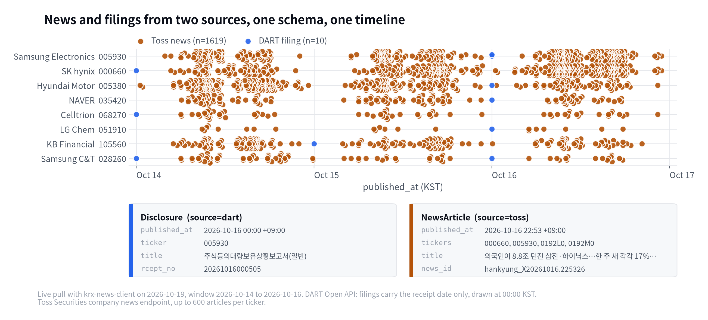

<div align="center">

<picture>
  <source media="(prefers-color-scheme: dark)" srcset="docs/images/brand/wordmark-dark.svg">
  
</picture>

# krx-news-client

**DART 공시와 토스증권 뉴스를 한 스키마로 받는 한국 주식 뉴스·공시 Python 클라이언트입니다.**

기사 본문, 종목별 과거 뉴스, 공시 원문까지 `pip install` 한 줄로 바로 씁니다.

[](https://github.com/younghwan91/krx-news-client/actions/workflows/ci.yml)
[](https://www.python.org/downloads/)
[](LICENSE)
[](https://www.linkedin.com/in/younghwan-chae/)

[문서](docs/guide.md) · [예제](examples/) · [English](README.en.md) · [이슈 제보](https://github.com/younghwan91/krx-news-client/issues)

</div>

<picture>
  <source media="(prefers-color-scheme: dark)" srcset="docs/images/hero-dark.png">
  
</picture>

<p align="center"><sub>DART 공시와 토스증권 뉴스를 종목별 한 타임라인에 묶어 같은 필드로 돌려줍니다.</sub></p>

## 빠른 시작

```bash
pip install krx-news-client   # Python 3.11 이상
```

```python
from krx_news_client import DartScraper
async with DartScraper.from_env() as dart:   # export DART_API_KEY=... (OpenDART 인증키)
    for d in (await dart.scrape_disclosures())[:3]: print(d.published_at.date(), d.company, d.title)
```

Jupyter나 `python -m asyncio`에서 그대로 실행됩니다(스크립트에서는 `async def main()`으로 감싸 `asyncio.run(main())`). 어제·오늘(KST) 전체 시장 공시가 최신순으로 나옵니다. 2026-11-26 실제 실행 결과입니다.

```text
2026-11-25 콜마비앤에이치 중간(분기)배당락
2026-11-25 SK증권제12호스팩 주권매매거래정지              (상장폐지 사유발생)
2026-11-25 유안타제16호스팩 주권매매거래정지              (상장폐지 사유발생)
```

OpenDART 인증키는 [opendart.fss.or.kr](https://opendart.fss.or.kr/)에서 무료로 받습니다. 토스 뉴스는 키 없이 `TossScraper`로 받습니다(아래 [예제 갤러리](#예제-갤러리)).

## 무엇을 하나

| 소스 | 데이터 | 수집 방식 |
|---|---|---|
| DART (dart.fss.or.kr) | 공시 목록·원문 | 공식 Open API (키 필요) |
| 토스증권 (tossinvest.com) | 대시보드 뉴스·기사 본문·종목별 뉴스 | 비공식 내부 API |

- **두 출처를 한 스키마로 묶습니다.** `Disclosure`와 `NewsArticle`이 `id`·`source`·`title`·`url`·`published_at`(KST, tz 포함)을 같은 이름으로 갖습니다.
- **조용한 0건 대신 예외를 올립니다.** 토스 응답 형식이 바뀌면 `TossResponseError`, 잘못된 종목코드나 페이지 크기는 `ValueError`, DART 일한도 소진은 `DartQuotaExceededError`를 냅니다.
- **종목별 과거 뉴스를 페이지로 넘깁니다.** `scrape_company_news()`로 최대 100건씩 토스가 허용하는 오프셋 10,000건까지 조회합니다.
- **DART 폴링과 백필을 나눕니다.** `scrape_disclosures()`는 다중 키 자동 전환과 관용적 폴링을, `search_disclosures*()`·`fetch_document()`는 엄격한 백필을 맡습니다.
- **중복을 걸러냅니다.** `Deduplicator`가 기사는 `id`, 공시는 접수번호(`rcept_no`) 기준으로 처음 본 항목만 넘깁니다.

상세 코드 예제는 [가이드](docs/guide.md#상세-사용법)와 [`examples/`](examples/)에서 볼 수 있습니다. OpenDART 직접 호출·네이버·pykrx·FinanceDataReader와 무엇이 다른지는 [다른 방법과 비교](docs/comparison.md)에 정리해 두었습니다.

## 예제 갤러리

아래 조각은 `async with DartScraper.from_env() as dart, TossScraper() as toss:` 안에서 실행합니다(`from datetime import date`, `from krx_news_client import DartScraper, Deduplicator, TossScraper`). 모든 조각은 [`tests/test_readme_gallery.py`](tests/test_readme_gallery.py)가 목 응답으로 매번 실행해 확인합니다.

<!-- gallery:start -->
**관심 종목 공시 알림** — 폴링 루프 한 바퀴. 새 공시만, 정정 공시는 빼고 받습니다.

```python
watch, seen = {"005930", "000660"}, Deduplicator()
for d in seen.filter_new(await dart.scrape_disclosures()):
    if d.ticker in watch and not d.is_correction: print(d.company, d.title, d.url)
```

**종목 뉴스 타임라인** — 종목코드로 과거 뉴스를 넘겨 오래된 순으로 찍습니다.

```python
news = await toss.scrape_company_news("005930", since=date(2026, 11, 1), max_pages=3)
for a in reversed(news):  # 결과는 최신순
    print(f"{a.published_at:%m-%d %H:%M}  {a.title}  ({a.author})")
```

**뉴스와 공시를 한 타임라인으로** — 두 모델이 `published_at`(KST)·`source`·`title`을 같은 이름으로 가집니다.

```python
news = await toss.scrape_company_news("005930", since=date(2026, 11, 20), max_pages=1)
filings = [d for d in await dart.scrape_disclosures(bgn_de="20261120") if d.ticker == "005930"]
for x in sorted([*news, *filings], key=lambda x: x.published_at): print(x.published_at.date(), x.source, x.title)
```

**LLM 입력 만들기** — 최신 기사 본문 전체를 프롬프트로. 만든 `prompt`를 쓰는 LLM SDK에 넘기면 됩니다.

```python
[latest] = await toss.scrape_company_news("005930", max_pages=1, page_size=1)
article = await toss.fetch_article_detail(latest.news_id)
prompt = f"다음 기사를 세 줄로 요약해 줘.\n\n# {article.title}\n\n{article.content}"
```

**공시 원문 텍스트** — 접수번호로 원문 zip을 받아 태그를 걷어낸 본문을 꺼냅니다.

```python
d = next(d for d in await dart.scrape_disclosures() if not d.is_correction)
[doc, *_] = await dart.fetch_document(d.rcept_no)
print(d.title, doc.text[:300])
```
<!-- gallery:end -->

## 토스 사용 시 주의

토스는 비공식 내부 API라 예고 없이 막히거나 형식이 바뀔 수 있습니다.

> **2026-11-26 확인:** 토스가 브라우저 세션 쿠키 없는 요청을 `400 invalid-client-state`로 거절하고 있어 `TossScraper`의 요청이 실패합니다. DART 기능은 영향이 없습니다. 진행 상황은 [CHANGELOG](CHANGELOG.md)에 적습니다.

- **코드는 6자리만 받습니다.** `A` 접두어는 자동으로 벗기며 그 외 형식은 요청 전에 `ValueError`를 냅니다.
- **페이지는 1부터, 크기는 100까지입니다.** `number=0`이나 `size=101` 이상은 요청 전에 `ValueError`를 냅니다.
- **오프셋 한계가 10,000건입니다.** `number × size`가 10,000을 넘기면 토스가 400을 주므로 대형주는 6개월에 못 미칩니다.
- **`lastPage`를 믿을 수 없습니다.** 빈 페이지가 나올 때까지 넘기고 `id`로 중복을 걷어낸 뒤 최신순으로 정렬합니다.

전체 주의사항과 응답 필드, 아키텍처는 [토스 사용 시 주의](docs/guide.md#토스-사용-시-주의)에 정리해 두었습니다.

## 문서

| 문서 | 내용 |
|---|---|
| [가이드](docs/guide.md) | 토스·DART 상세 사용법, 설계 배경, 토스 API 주의사항, 응답 필드, 구조 |
| [다른 방법과 비교](docs/comparison.md) | OpenDART 직접 호출·네이버·pykrx·FinanceDataReader와 다룬 범위와 코드 비교 |
| [예제](examples/) | 기본 사용법과 종목 알림 폴링 예제 |
| [변경 이력](CHANGELOG.md) | 버전별 변경 사항 |

## 같이 쓰면 좋은 것

| 레포 | 무엇을 하나 |
|---|---|
| [kiwoom-client](https://github.com/younghwan91/kiwoom-client) | 키움 REST API 파이썬 클라이언트. 시세·수급·호가·주문과 실시간 WebSocket, MCP 서버 |
| [krx-fundamentals-client](https://github.com/younghwan91/krx-fundamentals-client) | DART·KRX·네이버에서 기업 펀더멘탈을 모아 Pydantic 모델로 돌려주는 라이브러리 |
| [fin-checkup](https://github.com/younghwan91/fin-checkup) | 상장사 재무제표를 지표 17개 신호등으로 읽어 주는 무료 도구. 계산식·경계값 공개, 투자권유 없음 |

## 기여 및 지원

- 기여 방법(개발 환경·테스트·커밋 규칙)은 [CONTRIBUTING.md](CONTRIBUTING.md), 처음이라면 [good first issue](https://github.com/younghwan91/krx-news-client/issues?q=is%3Aissue+is%3Aopen+label%3A%22good+first+issue%22)부터 보세요.
- 버그 제보, 질문, 기능 제안은 [GitHub Issues](https://github.com/younghwan91/krx-news-client/issues)에 남겨 주세요.
- 만든 사람: **채영환 (Younghwan Chae)** · [GitHub @younghwan91](https://github.com/younghwan91) · [LinkedIn](https://www.linkedin.com/in/younghwan-chae/)

## 라이선스

Apache License 2.0 — 전문은 [LICENSE](LICENSE)를 참고하세요.
