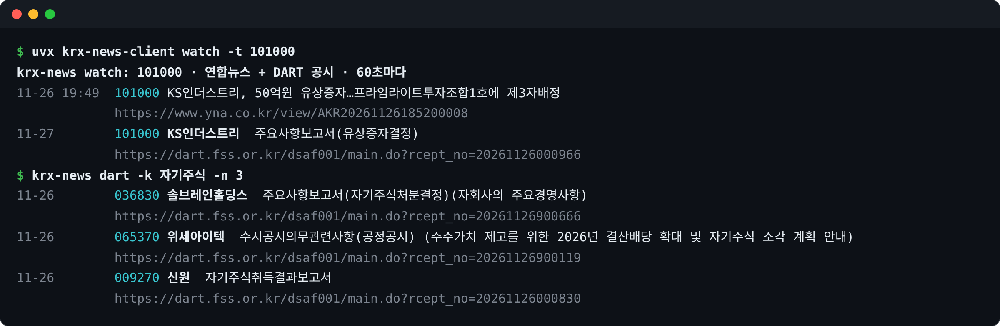

<div align="center">

<picture>
  <source media="(prefers-color-scheme: dark)" srcset="docs/images/brand/wordmark-dark.svg">
  
</picture>

# krx-news-client

**DART 공시와 한국 증시 뉴스(연합뉴스 RSS·네이버 검색 API)를 한 스키마로 받는 Python 클라이언트입니다.**

키 없는 뉴스 피드부터 종목 뉴스 검색, 공시 원문까지 씁니다. 파이썬 코드로도, 터미널에서 `uvx krx-news-client` 한 줄로도, AI 에이전트의 [MCP 서버](#ai-에이전트mcp)로도 쓸 수 있습니다.

[](https://github.com/younghwan91/krx-news-client/actions/workflows/ci.yml)
[](https://www.python.org/downloads/)
[](LICENSE)
[](https://www.linkedin.com/in/younghwan-chae/)

[문서](docs/guide.md) · [예제](examples/) · [English](README.en.md) · [이슈 제보](https://github.com/younghwan91/krx-news-client/issues)

</div>

<picture>
  <source media="(prefers-color-scheme: dark)" srcset="docs/images/hero-dark.png">
  
</picture>

<p align="center"><sub>뉴스와 DART 공시를 종목별 한 타임라인에 묶어 같은 필드로 돌려줍니다. 그림의 뉴스는 2026-11-26 차단 전의 토스증권 실행 결과입니다.</sub></p>

## 빠른 시작

```bash
pip install krx-news-client   # Python 3.11 이상
```

```python
from krx_news_client import YonhapScraper
async with YonhapScraper() as yna:   # 키 없음 (연합뉴스 마켓+ RSS)
    for a in (await yna.scrape_news())[:3]: print(f"{a.published_at:%m-%d %H:%M}", a.tickers, a.title)
```

Jupyter나 `python -m asyncio`에서 그대로 실행됩니다(스크립트에서는 `async def main()`으로 감싸 `asyncio.run(main())`). 연합뉴스 마켓+ 최신 기사가 최신순으로 나오고, 기사에 `회사명[종목코드]` 표기가 있으면 `tickers`에 담깁니다. 2026-11-26 실제 실행 결과입니다.

```text
11-26 19:49 ['101000'] KS인더스트리, 50억원 유상증자…프라임라이트투자조합1호에 제3자배정
11-26 18:54 [] 자본시장개혁기구 수장에 메리츠 김용범…민간에 전권 부여(종합)
11-26 18:35 [] 무디스 "AI확산에 동일 산업 내 기업 간 신용도 격차 확대될 것"
```

공시는 `DartScraper.from_env()`(`DART_API_KEY`, [opendart.fss.or.kr](https://opendart.fss.or.kr/)에서 무료 발급), 종목명으로 찾는 뉴스는 `NaverNewsScraper.from_env()`(`NAVER_CLIENT_ID`·`NAVER_CLIENT_SECRET`, [네이버 개발자 센터](https://developers.naver.com/apps/#/register)에서 "검색" API로 무료 발급)로 받습니다(아래 [예제 갤러리](#예제-갤러리)).

## 터미널에서 바로

설치 없이 한 줄로 실행합니다. 키가 없어도 연합뉴스 마켓+ 최신 기사가 나옵니다.



```bash
uvx krx-news-client                         # 연합뉴스 마켓+ 최신 기사 (키 없음)
uvx krx-news-client watch -t 005930 000660  # 관심 종목의 새 기사·공시가 뜰 때마다 한 줄씩
```

`pip install krx-news-client`(0.6.0 이상)로 설치했다면 같은 명령을 `krx-news`로 씁니다.

| 명령 | 하는 일 | 키 |
|---|---|---|
| `krx-news` (`news`) | 연합뉴스 섹션 최신 기사. `-t 005930`으로 종목만, `--json`으로 JSON | 없음 |
| `krx-news watch` | 새 기사(60초마다)·공시(5분마다)를 처음 본 것만 찍습니다. `Ctrl+C`로 끝냅니다 | 공시는 `DART_API_KEY` |
| `krx-news dart -k 자기주식` | 최근 공시를 종목·제목 키워드·시장으로 거릅니다. 정정 공시는 기본으로 뺍니다 | `DART_API_KEY` |
| `krx-news doc 20261126000830` | 접수번호의 공시 원문을 태그 걷어낸 텍스트로 | `DART_API_KEY` |
| `krx-news search 삼성전자` | 네이버 뉴스 검색, 원문 링크와 함께 | `NAVER_CLIENT_ID`·`_SECRET` |

## AI 에이전트(MCP)

Claude·Cursor 같은 에이전트가 DART 공시를 직접 찾고 **원문 본문까지 읽게** 하는 MCP 서버가 들어 있습니다. 목록 API만 감싸는 대신, 에이전트가 "무엇이 결정됐는지"를 원문에서 확인할 수 있습니다.

```bash
claude mcp add krx-news -e DART_API_KEY=발급받은키 -- uvx --from 'krx-news-client[mcp]' krx-news-client-mcp
```

| 도구 | 하는 일 |
|---|---|
| `recent_disclosures` | 최근 0~7일 공시를 종목코드·제목 키워드(`유상증자`·`자기주식`·`공급계약`)·시장으로 거릅니다 |
| `read_disclosure` | 접수번호로 공시 원문 텍스트를 읽습니다(`max_chars`까지) |
| 프롬프트 `disclosure_briefing` | 한 종목의 최근 주요 공시를 원문까지 읽고 건마다 세 줄로 정리합니다 |

"에코프로 이번 주 공시 원문까지 읽고 무엇이 결정됐는지 정리해 줘"처럼 물으면 됩니다. 뉴스 도구는 일부러 넣지 않았습니다. 연합뉴스 RSS는 "AI 학습 및 활용 금지"이고, 네이버 검색 API 약관은 결과를 AI 입력으로 쓰지 못하게 합니다([뉴스 소스와 이용 조건](#뉴스-소스와-이용-조건)). 모든 도구는 읽기 전용입니다.

## 무엇을 하나

| 소스 | 데이터 | 수집 방식 | 키 |
|---|---|---|---|
| DART (dart.fss.or.kr) | 공시 목록·원문 | 공식 Open API | 필요(무료) |
| 연합뉴스 (yna.co.kr) | 섹션별 최신 기사(마켓+·경제·산업·전체) | 공개 RSS | 없음 |
| 네이버 검색 API (openapi.naver.com) | 키워드·종목명 뉴스 검색 | 공식 Open API | 필요(무료) |
| 토스증권 (tossinvest.com) | 대시보드·종목별 뉴스, 기사 본문 | 비공식 내부 API | **2026-11-26부터 차단** |

- **여러 출처를 한 스키마로 묶습니다.** `Disclosure`와 `NewsArticle`이 `id`·`source`·`title`·`url`·`published_at`(KST, tz 포함)을 같은 이름으로 갖습니다.
- **조용한 0건 대신 예외를 올립니다.** 토스 차단은 `TossBlockedError`, 키가 없으면 발급 방법을 담은 `NaverKeyMissingError`·`ValueError`, 잘못된 페이지 인자는 요청 전에 `ValueError`, DART 일한도 소진은 `DartQuotaExceededError`를 냅니다.
- **종목 뉴스를 검색합니다.** `NaverNewsScraper.search_news("삼성전자", tickers=["005930"])`가 최신순으로 최대 1,099건까지 넘깁니다.
- **DART 폴링과 백필을 나눕니다.** `scrape_disclosures()`는 다중 키 자동 전환과 관용적 폴링을, `search_disclosures*()`·`fetch_document()`는 엄격한 백필을 맡습니다.
- **중복을 걸러냅니다.** `Deduplicator`가 기사는 `id`, 공시는 접수번호(`rcept_no`) 기준으로 처음 본 항목만 넘깁니다.

상세 코드 예제는 [가이드](docs/guide.md#상세-사용법)와 [`examples/`](examples/)에서 볼 수 있습니다. OpenDART 직접 호출·네이버·pykrx·FinanceDataReader와 무엇이 다른지는 [다른 방법과 비교](docs/comparison.md)에 정리해 두었습니다.

## 뉴스 소스와 이용 조건

뉴스는 남의 콘텐츠라 소스마다 쓸 수 있는 범위가 다릅니다. 라이브러리는 요청만 대신하고, 아래 조건을 지키는 것은 호출하는 쪽의 몫입니다(2026-11-26 각 공식 페이지에서 확인).

- **연합뉴스 RSS**는 `robots.txt`가 `/rss/`를 허용합니다. [RSS 안내](https://www.yna.co.kr/rss/index)에 따라 **비상업적 블로그와 개인 용도로만** 쓸 수 있고, 피드에 "무단 전재-재배포, AI 학습 및 활용 금지"가 붙어 있습니다. 상업적 이용은 연합뉴스와 따로 협의해야 합니다.
- **네이버 검색 API**는 [이용약관](https://developers.naver.com/products/terms/)상 네이버 검색결과임과 원본 출처·링크를 표시해야 하고, 결과를 **저장·캐싱할 수 없으며**(서버 이력 조회용 최대 21일 예외), **AI 입력·학습에 쓰거나 제3자에게 제공할 수 없습니다.** 장기 적재나 백테스트 데이터로는 맞지 않습니다.
- **DART**는 금융감독원 공식 Open API라 공시 데이터를 저장·분석하는 용도에 씁니다. LLM 입력이나 백테스트 적재가 필요하면 DART 공시를 쓰세요.
- 네이버 금융 페이지(`finance.naver.com`)는 robots가 `Disallow: /`라 이 라이브러리가 긁지 않습니다. 구글 뉴스 RSS(`news.google.com/rss`)도 robots가 막고 있어 넣지 않았습니다.

## 예제 갤러리

아래 조각은 `async with DartScraper.from_env() as dart, YonhapScraper() as yna, NaverNewsScraper.from_env() as naver:` 안에서 실행합니다(`from datetime import date`, `from krx_news_client import DartScraper, Deduplicator, NaverNewsScraper, YonhapScraper`). 모든 조각은 [`tests/test_readme_gallery.py`](tests/test_readme_gallery.py)가 목 응답으로 매번 실행해 확인합니다.

<!-- gallery:start -->
**관심 종목 공시 알림** — 폴링 루프 한 바퀴. 새 공시만, 정정 공시는 빼고 받습니다.

```python
watch, seen = {"005930", "000660"}, Deduplicator()
for d in seen.filter_new(await dart.scrape_disclosures()):
    if d.ticker in watch and not d.is_correction: print(d.company, d.title, d.url)
```

**관심 종목 속보** — 키 없이 연합뉴스 마켓+ 피드에서 관심 종목 기사만 고릅니다.

```python
watch = {"101000", "005930"}
for a in await yna.scrape_news(["market", "industry"]):
    if watch & set(a.tickers): print(f"{a.published_at:%H:%M}  {a.title}  {a.url}")
```

**종목 뉴스 검색** — 종목명으로 찾아 오래된 순으로 찍습니다. 출처 링크를 함께 보여 줍니다(네이버 약관).

```python
news = await naver.search_news("삼성전자", tickers=["005930"], since=date(2026, 11, 20))
for a in reversed(news):  # 결과는 최신순
    print(f"{a.published_at:%m-%d %H:%M}  {a.title}  {a.original_url}")
```

**뉴스와 공시를 한 타임라인으로** — 두 모델이 `published_at`(KST)·`source`·`title`을 같은 이름으로 가집니다.

```python
news = await naver.search_news("삼성전자", tickers=["005930"], since=date(2026, 11, 20), limit=20)
filings = [d for d in await dart.scrape_disclosures(bgn_de="20261120") if d.ticker == "005930"]
for x in sorted([*news, *filings], key=lambda x: x.published_at): print(x.published_at.date(), x.source, x.title)
```

**공시 원문을 LLM 입력으로** — 접수번호로 원문 zip을 받아 태그를 걷어낸 본문을 프롬프트로 만듭니다. 만든 `prompt`를 쓰는 LLM SDK에 넘기면 됩니다.

```python
d = next(d for d in await dart.scrape_disclosures() if not d.is_correction)
[doc, *_] = await dart.fetch_document(d.rcept_no)
prompt = f"다음 공시를 세 줄로 요약해 줘.\n\n# {d.title}\n\n{doc.text[:4000]}"
```
<!-- gallery:end -->

## 토스 사용 시 주의

토스는 비공식 내부 API라 예고 없이 막히거나 형식이 바뀔 수 있습니다.

> **2026-11-26부터 차단:** 토스가 브라우저 세션 쿠키 없는 요청을 `400 invalid-client-state`로 거절합니다. `TossScraper`는 이 응답을 받으면 재시도하지 않고 `TossBlockedError`(`TossResponseError`의 하위 클래스)를 올립니다. 세션을 흉내 내 우회하지 않습니다. 뉴스는 `YonhapScraper`나 `NaverNewsScraper`로 받으세요. 토스가 다시 열리면 아래 동작이 그대로 쓰입니다.

- **코드는 6자리만 받습니다.** `A` 접두어는 자동으로 벗기며 그 외 형식은 요청 전에 `ValueError`를 냅니다.
- **페이지는 1부터, 크기는 100까지입니다.** `number=0`이나 `size=101` 이상은 요청 전에 `ValueError`를 냅니다.
- **오프셋 한계가 10,000건입니다.** `number × size`가 10,000을 넘기면 토스가 400을 주므로 대형주는 6개월에 못 미칩니다.
- **`lastPage`를 믿을 수 없습니다.** 빈 페이지가 나올 때까지 넘기고 `id`로 중복을 걷어낸 뒤 최신순으로 정렬합니다.

전체 주의사항과 응답 필드, 아키텍처는 [토스 사용 시 주의](docs/guide.md#토스-사용-시-주의)에 정리해 두었습니다.

## 문서

| 문서 | 내용 |
|---|---|
| [가이드](docs/guide.md) | 토스·DART 상세 사용법(연합뉴스·네이버는 README와 docstring), 설계 배경, 토스 API 주의사항, 응답 필드, 구조 |
| [다른 방법과 비교](docs/comparison.md) | OpenDART 직접 호출·네이버·pykrx·FinanceDataReader와 다룬 범위와 코드 비교 |
| [예제](examples/) | 기본 사용법과 종목 알림 폴링 예제 |
| [변경 이력](CHANGELOG.md) | 버전별 변경 사항 |

## 같이 쓰면 좋은 것

| 레포 | 무엇을 하나 |
|---|---|
| [kiwoom-client](https://github.com/younghwan91/kiwoom-client) | 키움 REST API 파이썬 클라이언트. 시세·수급·호가·주문과 실시간 WebSocket, MCP 서버 |
| [krx-fundamentals-client](https://github.com/younghwan91/krx-fundamentals-client) | DART·KRX·네이버에서 기업 펀더멘탈을 모아 Pydantic 모델로 돌려주는 라이브러리 |
| [fin-checkup](https://github.com/younghwan91/fin-checkup) | 상장사 재무제표를 지표 17개 신호등으로 읽어 주는 무료 도구. 계산식·경계값 공개, 투자권유 없음 |

## 기여 및 지원

- 기여 방법(개발 환경·테스트·커밋 규칙)은 [CONTRIBUTING.md](CONTRIBUTING.md), 처음이라면 [good first issue](https://github.com/younghwan91/krx-news-client/issues?q=is%3Aissue+is%3Aopen+label%3A%22good+first+issue%22)부터 보세요.
- 버그 제보, 질문, 기능 제안은 [GitHub Issues](https://github.com/younghwan91/krx-news-client/issues)에 남겨 주세요.
- 만든 사람: **채영환 (Younghwan Chae)** · [GitHub @younghwan91](https://github.com/younghwan91) · [LinkedIn](https://www.linkedin.com/in/younghwan-chae/)

## 라이선스

Apache License 2.0 — 전문은 [LICENSE](LICENSE)를 참고하세요.
